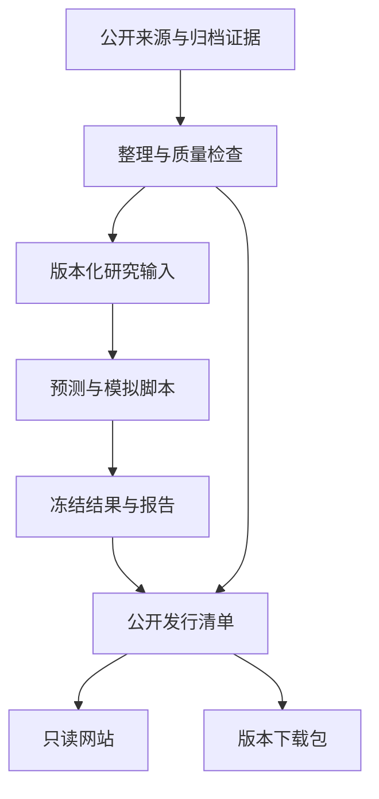

# 项目架构与扩展边界

## 1. 面向谁、解决什么问题

本项目服务于研究 CAISO 电力市场的产品、业务、算法和研发人员。

| 使用者 | 主要任务 | 入口 |
| --- | --- | --- |
| 业务与产品同事 | 看行情、供需、预测、评估和已有模拟，理解数据口径 | 公开只读网站 |
| 研究人员 | 下载同一版本的数据、报告与模型，复现并设计新实验 | 数据下载与研究源码 |
| 研发人员 | 维护界面、接口、构建和发布 | GitHub 仓库 |
| Codex | 在明确版本和指令下检查、修改、验证代码 | GitHub 仓库＋已发布的 Codex 环境 |

“能够访问网站”“能够修改仓库”“能够执行工作台后端”“能够使用 Codex 环境”分别授权，不能相互替代。

## 2. 应用与目录

| 模块 | 路径 | 对外行为 |
| --- | --- | --- |
| 公开查看版 | `apps/viewer/` | 在浏览器内读取公开快照、交互展示、下载文件；无数据库写入 |
| 完整工作台 | `apps/workbench/` | 保留原前后端实现；在线查询、导入、模拟与保存需要单独运行服务 |
| 研究脚本 | `apps/workbench/research/` | 数据处理、模型选型、预测和策略模拟；从显式输入得到结果文件 |
| 公开数据 | `data/published/` | 已审核的行情、供需、研究输出、报告与附件 |
| 离线交付 | `data/downloads/` | 供团队下载的自包含离线附件 |
| 项目脚本 | `scripts/` | 项目级安装、校验、发行辅助逻辑 |
| 团队文档 | `docs/` | 业务决策、协作规则、开发与接手说明 |

静态查看版由 GitHub Pages 承载。GitHub Pages 不运行 Python、服务端 API 或数据库；工作台源码纳入仓库后，后端仍需单独配置运行环境。静态网站与工作台的源码组织不能改变这一边界。

## 3. 数据与发布关系

这是数据发布的逻辑关系，不代表图中每一步已经配置为自动任务。当前已有数据和结果保持归档状态；自动采集、训练和发布需要独立配置与验证。

### 数据分层

| 层 | 内容 | 约束 |
| --- | --- | --- |
| 来源证据 | 官方响应、原始文档和下载附件 | 保留来源、采集时间和原始字节；不能将第三方原件统一重新授权 |
| 规范输入 | 时间对齐、单位明确、质量检查后的行情与研究特征 | 明确缺失、重复、时区和当时可得性 |
| 模型输出 | 预测值、区间、版本与生成时间 | 事前未知的实际值保持为空；历史预测不被新训练覆盖 |
| 评估与模拟 | 误差、覆盖率、方向、模拟计划与损益 | 写明样本、基线、费用、假设和是否独立评估 |
| 展示快照 | 网页所需的目录和适量 JSON/CSV | 与下载包绑定同一版本，首屏展示数据日期 |
| 发行附件 | 完整公开数据、旧版结果和复现包 | 通过文件清单与校验值确认完整性 |

`data/published/` 是本次共享版使用的公开发行资料。工作台中保留的研究输入及历史目录承担原脚本兼容职责；相同内容若在两处存在，不能分别静默更新。扩展时应通过明确的数据清单、生成脚本或版本映射保持一致，避免人为复制产生不同结果。

## 4. 现有功能边界

### 公开查看版

应保留市场概览、三枢纽行情、供需与官方预测、V1—V4 研究结果、模型指标、已有模拟和数据下载。可在浏览器进行筛选、切换和图表交互。

当某个日期、字段或附件未归档时，显示明确的“本快照未收录”状态。不能展示仍会调用私有服务的按钮，也不能用空白图表伪装加载成功。

### 完整工作台

原工作台包含服务端数据读取、预测导入、模拟执行和结果保存。源码迁入 GitHub 后，需要显式部署服务端、初始化存储并设置用户访问控制，才能让团队在线运行。

现有数据库及服务端账号不随源码自动迁移。首次独立部署应使用新的明确配置；对于跨用户实验，不得默认所有人读取和写入同一批全局记录。

### 研究与模型

保留冻结模型、数据与历史报告。新实验应显式给定输入版本、目标日期、生成时间、参数与输出位置。结果文件能够被工作台读取，不代表它已经通过研究验收或适合真实交易。

## 5. 扩展规则

### 新增一个数据来源

先说明业务用途、免费可用性、访问条件、字段单位、时间粒度与数据实际可得时间。实现抓取和解析后做质量检查，记录失败状态和最近成功时间，再发布为参考资料或模型输入。

不能把“已接入展示”直接写成“已用于预测”。若当前无法稳定获得，记录限制并继续使用已有输入，不使主流程停在资料缺口上。

### 新增一个模型版本

给出目标、输入版本、时间划分、基线、选型方法和接受标准。新输出使用新的版本标识，保留冻结 V4 供比较。价格误差、价差方向、区间覆盖和策略结果应分别评价。

对外展示需要能够从模型卡追溯到代码、数据、参数与结果；未达到独立验证要求的结果保持“开发评估”标记。

### 新增团队在线操作

以实际用户流程定义输入、任务状态、输出与异常。至少区分读取与写入权限、任务执行者、数据版本、实验记录归属、重复提交和失败重试。服务端负责鉴权；前端隐藏按钮不能替代访问控制。

### 扩展前端功能

优先保持一条清晰路径：选市场/枢纽和日期 → 看结果与口径 → 看依据和明细 → 下载或进入研究。复用同一数据源和字段定义，避免增加多个含义重叠的入口。

## 6. 发布与访问

GitHub 仓库负责源码和版本历史，Pages 负责公开静态网站，Releases 适合分发较大附件。网站所需资源应兼容项目子路径；不能假定所有资源都位于域名根路径。查看版通过 `PUBLIC_BASE_PATH` 或其构建脚本的 `--base` 参数配置实际发布前缀；不要把临时预览地址写入源码。

发布时应检查：

- 网站、报告、数据下载属于同一发行版本。
- 首页、主要模块、历史版本和下载入口不依赖原工作台私有域名。
- 运行时没有真实凭据或写入接口被意外带入公开前端。
- 所有必要附件在发行清单中有明确位置；遗漏的资料不能声称已全部上线。
- 实际同事能够在自己的网络中访问。构建成功和发布服务返回成功，都不等于所有用户网络已经验证。

当前实际部署和环境状态以根 README 及发行记录为准，本文描述架构，不证明任何远端操作已经完成。
